## Mới clone Project về thì làm gì?

copy example.env và đổi tên thành .env
`cp example.env .env`

Cập nhật cơ sở dữ liệu `npm run db:push` và `npm run db:generate`


## Cấu trúc dự án

Cập nhật file docs ở thư mục docs

| Nhiệm vụ | Đường dẫn thư mục / file |
| :--- | :--- |
| **Frontend UI & Pages** | [`src/app/`](file:///home/kien/blockchain/src/app) |
| **API Backend** | [`src/app/api/`](file:///home/kien/blockchain/src/app/api) & [`src/lib/`](file:///home/kien/blockchain/src/lib) |
| **Smart Contracts** | [`contracts/`](file:///home/kien/blockchain/contracts) |
| **Cơ sở dữ liệu** | [`prisma/schema.prisma`](file:///home/kien/blockchain/prisma/schema.prisma) |
| **Viết Unit & Contract Test** | [`test/unit/`](file:///home/kien/blockchain/test/unit) & [`test/contracts/`](file:///home/kien/blockchain/test/contracts) |


### Trước khi viết một tính năng mới

Quy trình làm việc
1. Chọn một card trên Linear.
2. Copy tên nhánh từ Linear.
3. Tạo nhánh local, thêm tiền tố phía trước: git switch -c feat/<tên-nhánh-linear> hoặc git checkout -b feat/<tên-nhánh-linear>
4. Code, commit, push.
5. Tạo PR, tiêu đề có tiền tố, ví dụ feat: thêm nút kết nối ví.
6. Nếu có conflict: chạy git pull origin main trên nhánh của bạn, sửa conflict, push lại.
7. Merge PR. Xóa nhánh nếu muốn (không bắt buộc).

Các prefix bao gồm:
- feat: tính năng mới
- fix: sửa lỗi
- docs: chỉ đổi tài liệu
- refactor: dọn code, không đổi hành vi
- chore: việc vặt (cấu hình, thư viện)


giả sử lên linear và copy tên nhánh là
nguyentrungkienhp202/nuo-6-s0-cap-nhat-dac-ta-mvp-theo-cac-diem-da-ra-soat

đây là tính năng thì thêm feat
thành quả cuối cùng: 

git switch -c "feat/nguyentrungkienhp202/nuo-6-s0-cap-nhat-dac-ta-mvp-theo-cac-diem-da-ra-soat"

Sau khi code xong có thể kiểm tra chất lượng với
- npm ci: cài đúng phiên bản thư viện.
- npx prisma db push: kiểm tra schema database.
- npx tsc --noEmit: kiểm tra lỗi TypeScript.
- npm run lint: kiểm tra quy tắc và chất lượng code.
- npm run test:unit: chạy unit test tại test/unit/.
- npm run test:contracts: chạy test smart contract tại test/contracts/.
- npm run build: kiểm tra ứng dụng có build thành công hay không.


Sau đó push lên:
git push -u origin feat/nguyentrungkienhp202/nuo-6-s0-cap-nhat-dac-ta-mvp-theo-cac-diem-da-ra-soat


### Quy trình thêm một tính năng mới

1. **Xác định vị trí cần chỉnh sửa**
   - Giao diện: `src/app/`
   - API/backend: `src/app/api/`
   - Logic dùng chung: `src/lib/`
   - Smart contract: `contracts/`
   - Database: `prisma/schema.prisma`

2. **Triển khai tính năng**
   - Cập nhật schema nếu tính năng cần thêm dữ liệu mới.
   - Viết API xử lý nghiệp vụ tại `src/app/api/`.
   - Cập nhật giao diện tại `src/app/`.
   - Nếu liên quan blockchain, chỉnh sửa smart contract trong `contracts/`.

3. **Viết kiểm thử**
   - Unit test cho các hàm xử lý tại `test/unit/`.
   - Contract test cho smart contract tại `test/contracts/`.

4. **Chạy kiểm thử**

   ```bash
   npm run test:unit
   npm run test:contracts
   ```


## Thử tạo bảng database bằng prisma

Thêm bảng vào file schema.prisma

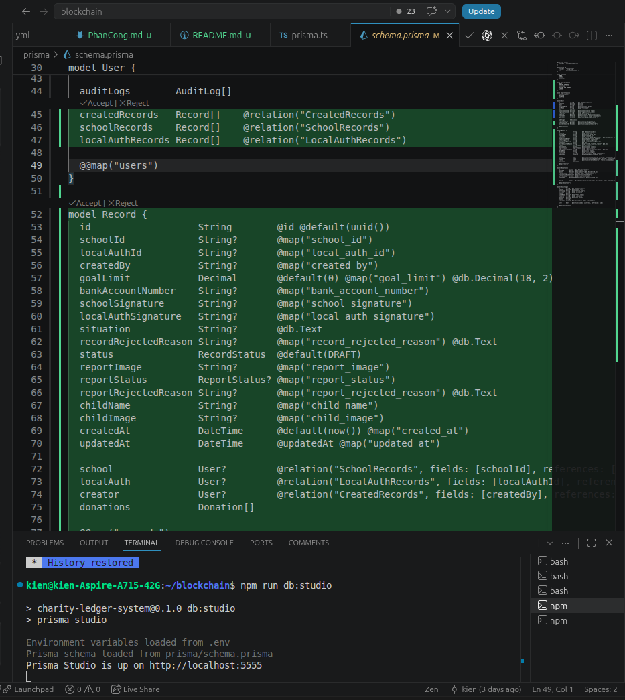

Chạy `npm run db:push` để tạo bảng trong cơ sở dữ liệu postgres

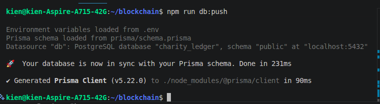


Chạy `npm run db:generate` để tạo các hàm có thể sử dụng trong typescript


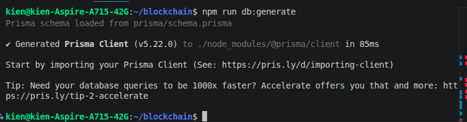


Chạy `npm run db:studio` để mở giao diện web tại http://localhost:5555, thao tác với cơ sở dữ liệu bằng chuột

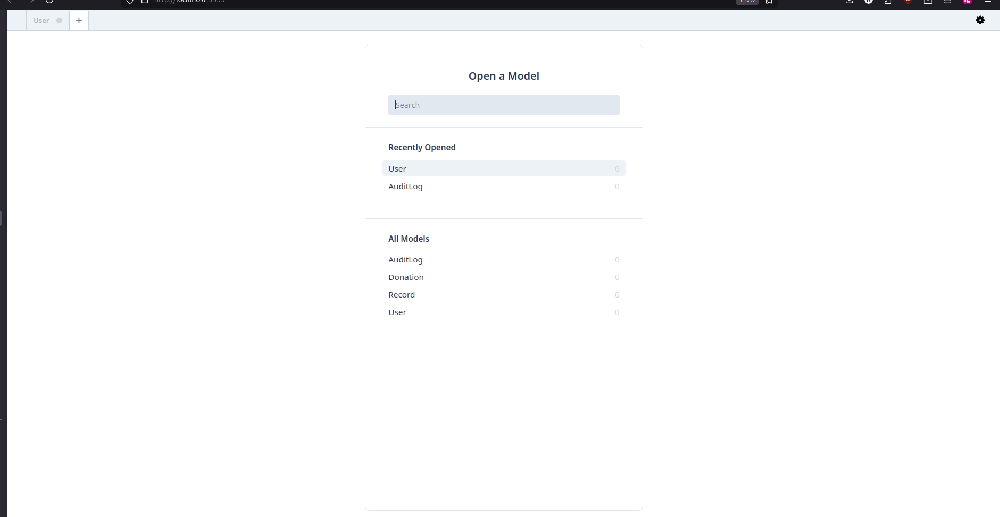


## Chuyển thử ETH trên MetaMask

Chạy lệnh
`npm hardhat node`

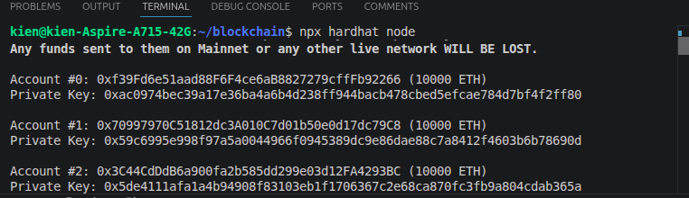


Chuuẩn bị hai tài khoản
Tài khoản gửi (Account #0)


Import tài khoản Metamask

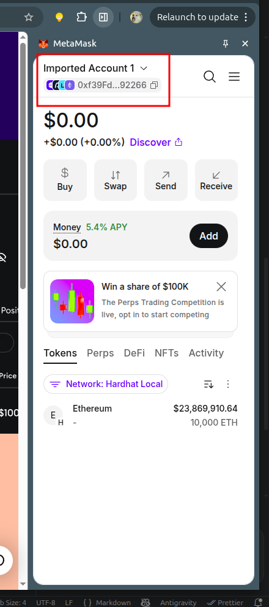

Bấm vào add wallet

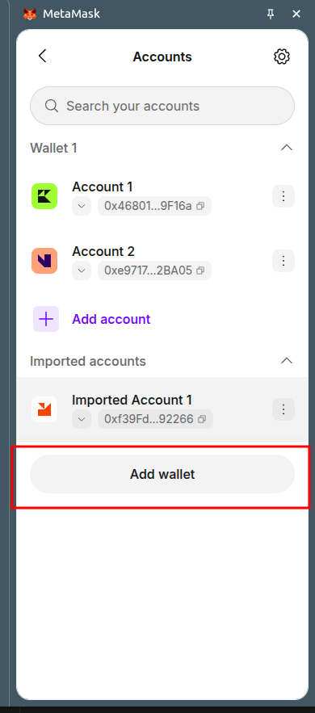

Nhập private key của Account, ở đây thử nhập:
0x59c6995e998f97a5a0044966f0945389dc9e86dae88c7a8412f4603b6b78690d
(Account #1)

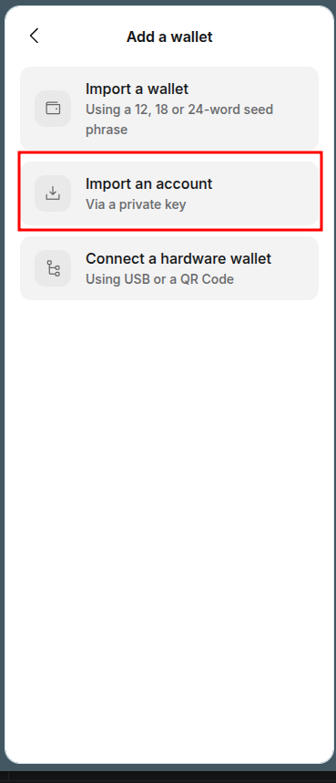

Import thành công

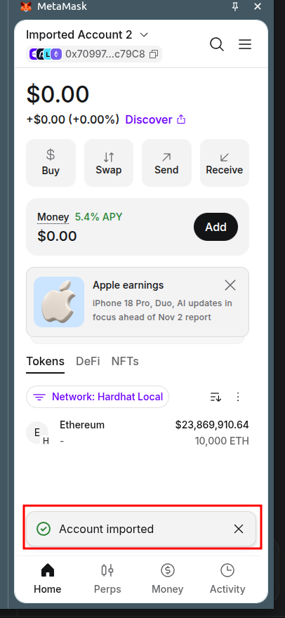

Thử chuyển tiền vào tài khoản bằng cách copy địa chỉ

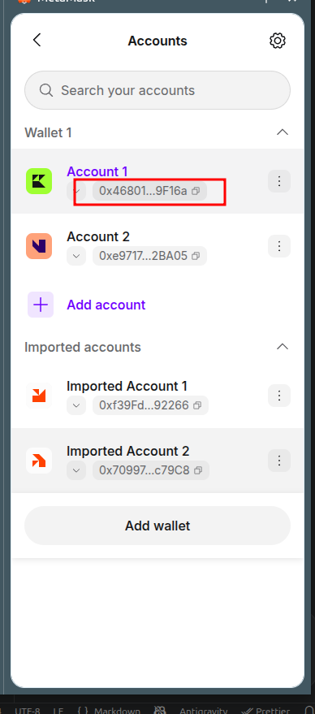

Bấm vào send

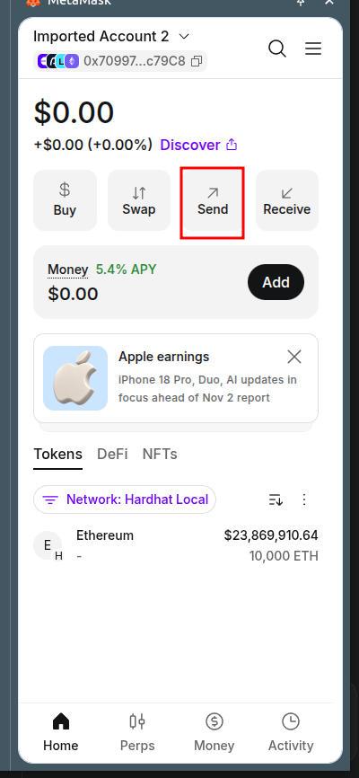

Chọn loại tài sản


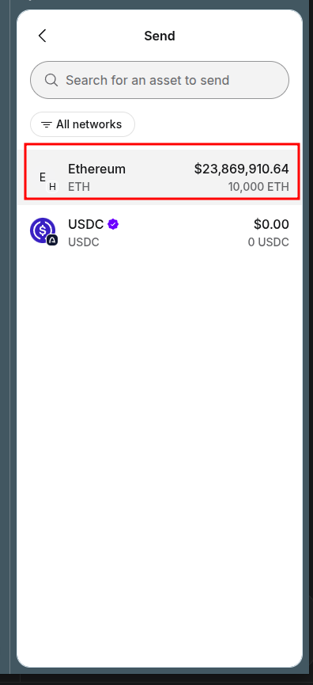

Dán địa chỉ tài khoản vừa copy vào rồi chuyển

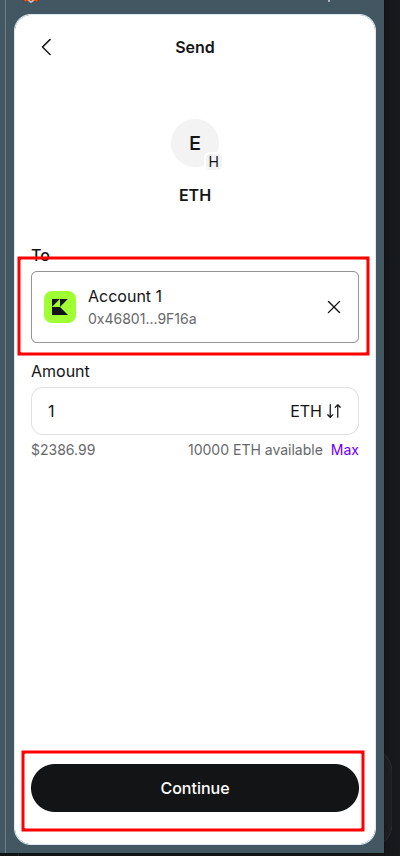

Kết quả

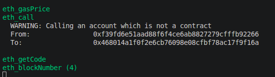


## On-chain là ở đâu?

Backend hoặc MetaMask
        |
        | gửi giao dịch
        v
Hardhat node
        |
        | thực thi smart contract
        v
CharityLedger.records["HS-001"]
        |
        | lưu commitment
        v
0xabc123...

Dữ liệu on-chain là dữ liệu của smart contract trên Hardhat node
