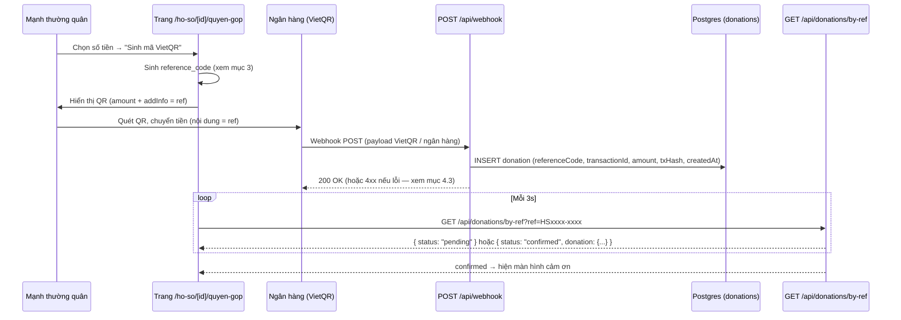

# BACKEND INTEGRATION GUIDE — Trang công khai & luồng quyên góp VietQR

**Người đọc:** đồng đội phụ trách backend
**Người viết:** người làm frontend
**Ngày:** 2026-11-15 · **Nhánh:** `feat/trinhbinhkhangit/giao-dien-cong-khai-mtq`

Tài liệu này mô tả những gì frontend đã làm xong và **chính xác** cách backend phải hiện thực để luồng quyên góp chạy được end-to-end.

---

## 0. Tổng quan hiện trạng

| Thành phần | Trạng thái |
|---|---|
| Trang công khai (`/`, `/ho-so`, `/ho-so/[id]`, `/tra-cuu`, `/huong-dan`) | ✅ Xong (đọc Postgres trực tiếp qua Prisma) |
| Trang quyên góp (`/ho-so/[id]/quyen-gop`) | ✅ Xong — phần QR + countdown + poll `/api/donations/by-ref` |
| Webhook nhận tiền (`POST /api/webhook`) | ⏳ **Backend tự viết** (đã có file placeholder `src/app/api/webhook/route.ts`) |
| `GET /api/donations/by-ref` | ⏳ **Cần viết** |
| `GET /api/donations/tra-cuu` | ⏳ **Cần viết** |

Front-end **không** dùng route `/api/public/*` — server components truy vấn Prisma trực tiếp. Nhóm không cần viết API cho các trang công khai.

## 1. Sơ đồ luồng (end-to-end)



## 2. Reference code — quy tắc tạo mã (đã cài đặt ở frontend)

Sinh một lần, lưu ở `localStorage` key `qr-ref:<recordId>`:

```
shortCode = record.id (bỏ dấu "-", uppercase)
reference_code = "HS" + shortCode.slice(0, 5) + "-" + randomHex4
Ví dụ: HSx9Kq2A-1F3E
regex kiểm tra: ^HS[A-Z0-9]{5}-[A-F0-9]{4}$
```

**Backend phải biết ghép `reference_code` ↔ hồ sơ**. 2 cách:

### Cách A — parse prefix (đơn giản, MVP)
1. Parse `reference_code` bằng regex trên, lấy 5 ký tự giữa `HS` và `-`.
2. Đó là 5 ký tự đầu của `record.id` (đã uppercase, bỏ "-") — vì uuid = `xxxxxxxx-...` → tìm `record` có `id` bắt đầu bằng (so khớp không phân biệt hoa thường) 5 ký tự đó.
3. Guard: không tìm thấy → log `pending`, không ghi donation (container `Chờ gán hồ sơ`).

**Độ unique**: 5 ký tự hex = ~1M tiền tố — đủ với < vài trăm hồ sơ MVP.

### Cách B — lưu bảng chờ (khuyến nghị production)
Khi UI sinh QR, frontend gọi `POST /api/donations/pending { recordId, ref }` và backend lưu bảng `pending_transactions` (hoặc cột `donations.referenceCode` trạng thái `PENDING`). Webhook đến → join theo `ref` → ghi donation hoặc chuyển sang `Chờ gán hồ sơ` nếu lệch mã.

## 3. Trang quyên góp — chi tiết kỹ thuật

File: `src/app/ho-so/[id]/quyen-gop/donation-panel.tsx` (client component)

- Số tiền: preset `[100k, 200k, 500k, 1M, 2M]` hoặc tự nhập (tối thiểu 1.000 VNĐ).
- QR sinh qua ảnh `img.vietqr.io`:

```
https://img.vietqr.io/image/{BANK_ID}-{accountNo}-{TEMPLATE}.png?amount={amount}&addInfo={ref}&accountName={recipient}
```
  - `BANK_ID`: `NEXT_PUBLIC_VIETQR_BANK_ID` (mặc định `MB` — MB Bank)
  - `accountNo`: lấy **trực tiếp từ hồ sơ** (`record.bankAccountNumber` — tài khoản nhà trường nhận tiền)
  - `TEMPLATE`: `NEXT_PUBLIC_VIETQR_TEMPLATE` (mặc định `compact2`)
  - `accountName`: tên nhà trường
- Countdown **10 phút**. Hết giờ vẫn giữ QR, chỉ ngừng poll.
- Poll `/api/donations/by-ref` mỗi 3s. Nếu HTTP 404/501 → xuất hiện nút
  **“Giả lập tiền đã vào”** (để team demo). Nút này chỉ bấm được khi backend chưa sẵn sàng; sau khi backend xong, nút tự biến mất.
- Sau `confirmed` → hiển thị màn hình cảm ơn, dẫn về trang hồ sơ.

**Máy test:** nếu hồ sơ không ở trạng thái `RECEIVING`, trang hiển thị thông báo “Hồ sơ chưa mở quyên góp” thay vì QR.

## 4. API contract cần backend viết

### 4.1 `GET /api/donations/by-ref?ref=HSxxxx-xxxx`

| | |
|---|---|
| Auth | **Công khai** (không dùng `auth()`) |
| Response 200 – đang chờ | `{ "status": "pending", "ref": "HSxxxx-xxxx" }` |
| Response 200 – đã nhận | `{ "status": "confirmed", "donation": { "id": "uuid", "amount": 200000, "transactionId": "...", "createdAt": "..." } }` |
| Response 404 | `{ "error": "not_ready" }` — UI sẽ hiện nút giả lập |
| Response 400 | `{ "error": "invalid_ref" }` (regex không khớp) |

Gợi ý SQL phía backend (Prisma):

```ts
const ref = new URL(req.url).searchParams.get("ref") ?? "";
if (!/^HS[A-Z0-9]{5}-[A-F0-9]{4}$/.test(ref)) return 400;
const d = await prisma.donation.findUnique({ where: { referenceCode: ref } });
if (!d) return 200, { status: "pending", ref };
return 200, { status: "confirmed", donation: { id: d.id, amount: d.amount, transactionId: d.transactionId, createdAt: d.createdAt } };
```

### 4.2 `GET /api/donations/tra-cuu?transactionId=...`

| | |
|---|---|
| Auth | **Công khai** |
| Response 200 – tìm thấy | `{ "found": true, "status": "CONFIRMED", "amount": 200000, "createdAt": "...", "recordId": "uuid" }` |
| Response 200 – không thấy | `{ "found": false }` |
| Response 500/501 | UI hiện phần “chưa tìm thấy / lỗi, thử lại sau” |

### 4.3 `POST /api/webhook` (lõi)

Nhận IPN/webhook từ ngân hàng/VietQR. Duy nhất một lần insert — `transactionId` là `@unique` nên tự chống ghi trùng.

```ts
// Sườn gợi ý — bên bạn tự thêm verify signature (mỗi ngân hàng 1 kiểu)
export async function POST(req: Request) {
  const body = await req.json().catch(() => null);
  const ref = extractRef(body);            // lấy từ content/addInfo
  const amount = extractAmount(body);      // số tiền (VNĐ)
  const txId = extractTransactionId(body); // mã giao dịch ngân hàng — UNIQUE
  const txHash = extractTxHash(body);      // nếu có

  const record = await findRecordByRef(ref);   // mục 2, cách A hoặc B
  if (!record) return NextResponse.json({ ok: false, error: "unknown_ref" }, { status: 400 });

  await prisma.donation.upsert({
    where: { transactionId: txId },
    update: {},
    create: {
      recordId: record.id,
      amount,
      transactionId: txId,
      referenceCode: ref,
      transactionHash: txHash ?? null,
    },
  });
  return NextResponse.json({ ok: true });
}
```

**Kiểm tra bắt buộc:**
- Xác thực request thật từ VietQR (header `x-signature` / HMAC tuỳ dịch vụ).
- `transactionId` không NULL (schema đã `@unique`).
- `amount` parse sang `Decimal` cho `@db.Decimal(18,2)`.
- Log payload ra `audit_logs` để debug.
- Trả `200` nhanh — đừng xử lý nặng trong webhook.

## 5. Biến môi trường cần thêm

```
# .env.example (frontend gợi ý, backend tuỳ nhóm quyết định)
NEXT_PUBLIC_VIETQR_BANK_ID="MB"          # mã ngân hàng VietQR (MB = MB Bank)
NEXT_PUBLIC_VIETQR_TEMPLATE="compact2"   # mẫu QR compact2 / compact / qr_only...
WEBHOOK_SECRET="..."                     # chuỗi verify webhook (đã có trong .env.example)
VIETQR_ACCOUNT_NO=""                     # nếu muốn fallback khi hồ sơ thiếu TK
VIETQR_ACCOUNT_NAME=""
```

## 6. Dữ liệu demo để test

- DB hiện có 2 hồ sơ seed. **Để demo quyên góp**, cần hồ sơ ở trạng thái `RECEIVING`. Chạy SQL:

```powershell
docker exec charity_ledger_postgres psql -U postgres -d charity_ledger -c "UPDATE records SET status='RECEIVING' WHERE situation LIKE '%Xã A%'"
```

- Thêm vài donation mẫu:

```powershell
docker exec charity_ledger_postgres psql -U postgres -d charity_ledger -c "INSERT INTO donations (transaction_id, record_id, amount, reference_code, created_at, id) SELECT 'TX' || substr(md5(random()::text),1,8), id, 200000, 'HS' || upper(substr(replace(id,'-',''),1,5)) || '-A1B2', now(), gen_random_uuid() FROM records LIMIT 1"
```

## 7. Checklist nghiệm thu cho backend

- [ ] `/api/donations/by-ref` trả đúng 2 trạng thái
- [ ] Webhook ghi vào DB, trùng `transactionId` không gây lỗi 500
- [ ] `transactionId` hiển thị được ở trang `/ho-so/[id]` (Sao kê)
- [ ] `tra-cuu` tìm được theo giao dịch vừa test
- [ ] Postman collection / curl sample ghi vào `docs/`

## 8. Tham chiếu file

| File | Ghi chú |
|---|---|
| `src/app/ho-so/[id]/quyen-gop/donation-panel.tsx` | QR + poll + countdown |
| `src/app/tra-cuu/page.tsx` | Gọi `/api/donations/tra-cuu` |
| `src/lib/public.ts` | Aggregate helpers (prisma) |
| `prisma/schema.prisma` | model `Donation` có `referenceCode`, `transactionHash`, `transactionId @unique` |
| `docs/PhanCong.md`, `docs/Questions.md` | Nghiệp vụ gốc |
