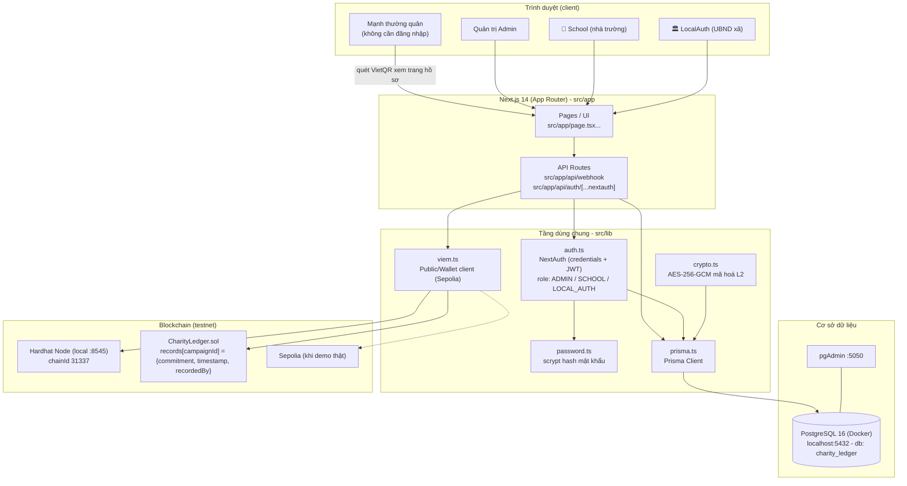
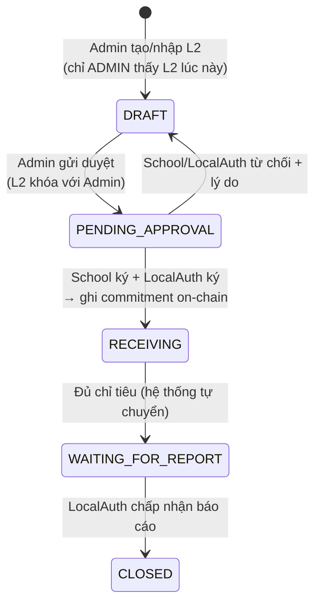
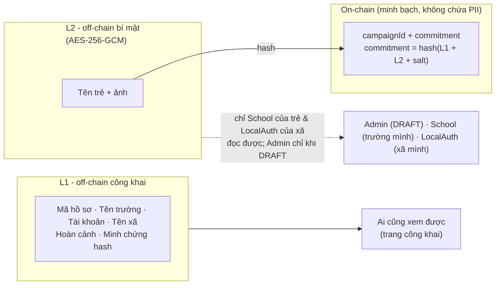
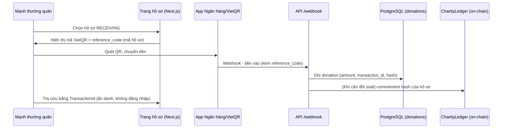
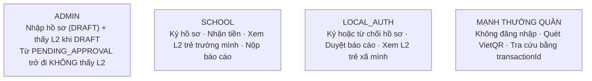

# Kiến trúc hệ thống NuôiEm - Charity Ledger System

> Cập nhật: 2026-11-10
> Xem sơ đồ: GitHub tự render Mermaid trong file này. VS Code: mở file này → Ctrl+Shift+V (preview). Không cần cài extension.

## 1. Kiến trúc tổng thể



## 2. Vòng đời hồ sơ (state machine)



## 3. Luồng dữ liệu & phân quyền xem



## 4. Luồng quyên góp (VietQR + webhook)



## 5. Ai làm gì (tóm tắt quyền)



## 6. Cấu trúc thư mục đáng chú ý

```
src/app/api/webhook/route.ts     - nhận webhook VietQR
src/app/api/auth/[...nextauth]/  - đăng nhập (credentials + JWT)
src/lib/auth.ts                  - cấu hình NextAuth + phân quyền
src/lib/crypto.ts                - AES-256-GCM cho L2
src/lib/password.ts              - scrypt hash mật khẩu
prisma/schema.prisma             - users, records, donations, audit_logs
prisma/seed.ts                   - seed 5 tài khoản demo + hồ sơ mẫu
contracts/CharityLedger.sol      - smart contract ghi commitment on-chain
docs/reports/                    - báo cáo task theo quy chuẩn nhóm
```
