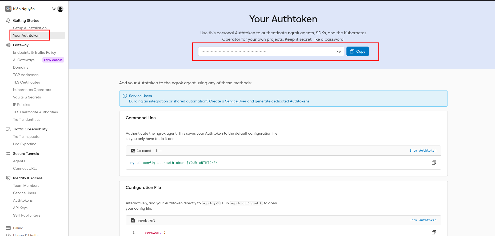
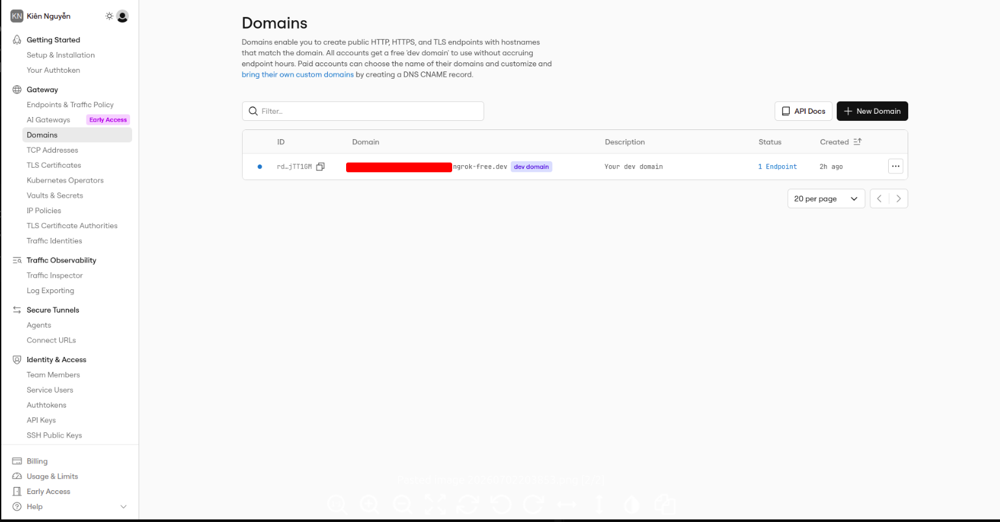
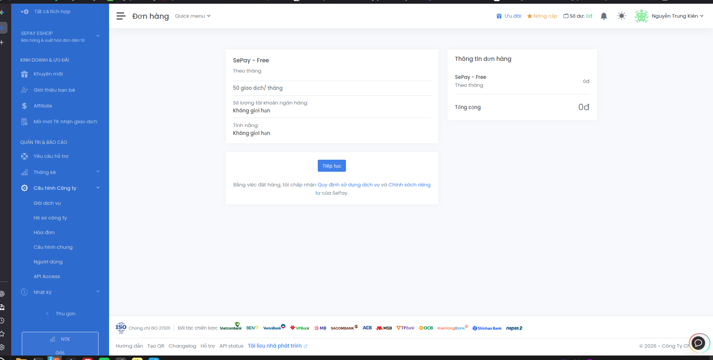
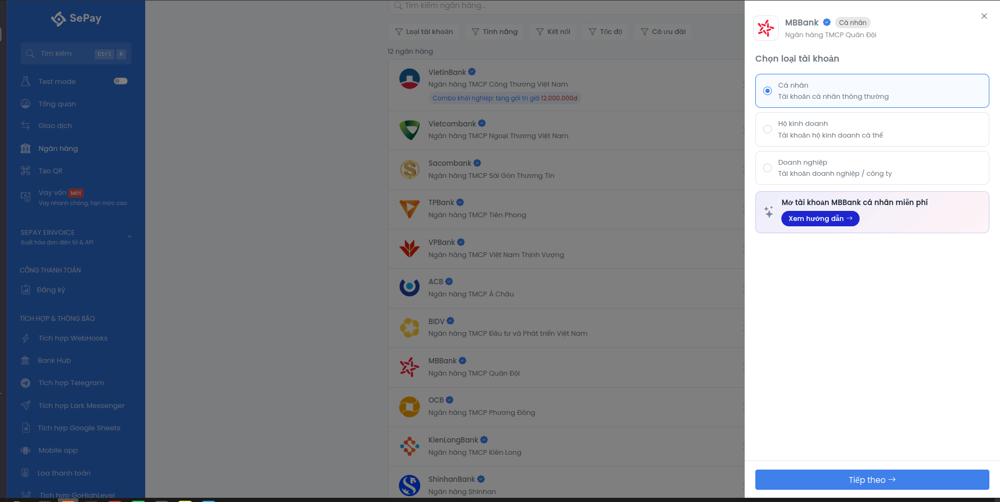
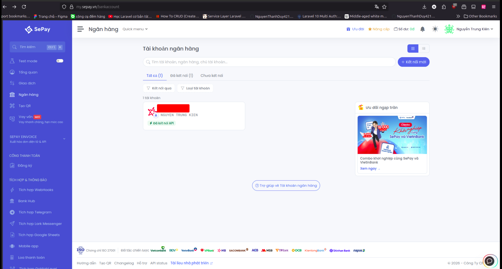
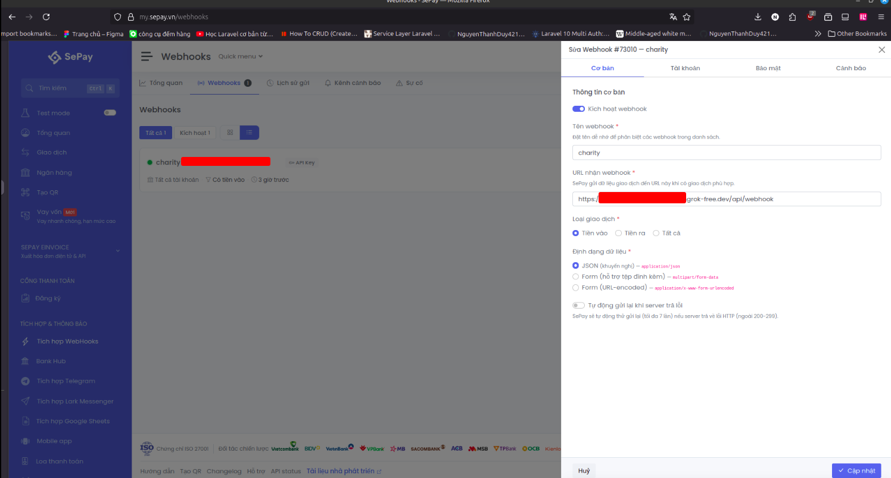
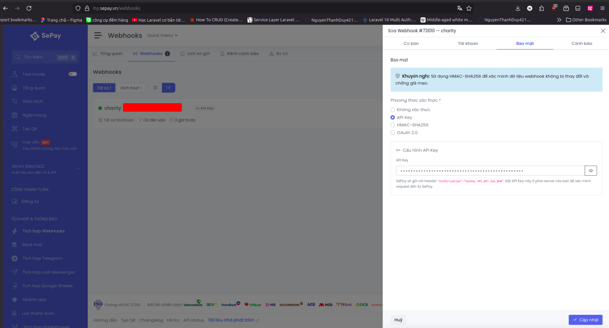
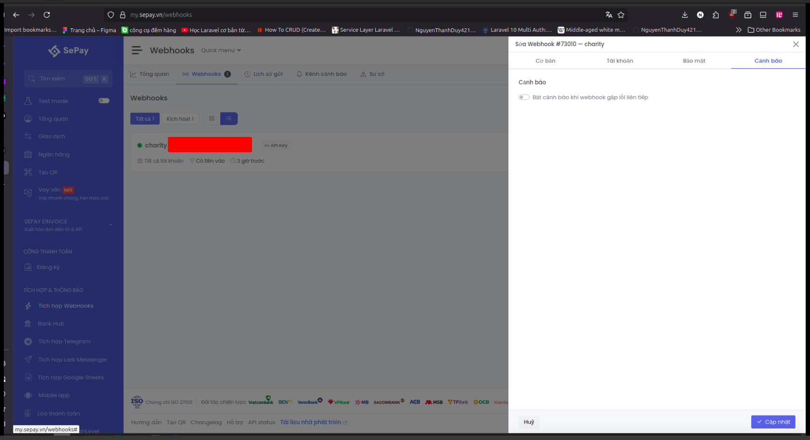
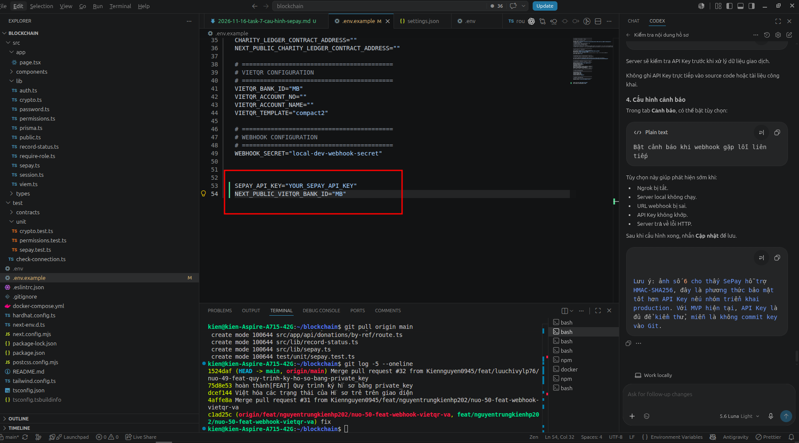

## Bức tranh tổng thể:

Mạnh thường quân
  → quét VietQR
  → chuyển tiền qua ngân hàng
  → tiền vào tài khoản trường
  → SePay phát hiện giao dịch
  → SePay gửi webhook đến URL public
  → ngrok chuyển request về localhost
  → server nhận và xử lý webhook
  → đọc số tiền, transactionId, nội dung
  → lấy mã hồ sơ
  → gán donation vào hồ sơ
  → frontend polling và hiển thị “Đã nhận”

VietQR: Tạo mã QR chứa số tài khoản ngân hàng, số tiền và nội dung/mã hồ sơ
Ngân hàng: thực hiện giao dịch thật
SePay: Theo dõi tài khoản ngân hàng, nhận biết giao idchj và gửi dữ liệu giao dịch qua webhook: là endpoint của server, do dev tự tạo, ví dụ /api/webhook để nhận dữ liệu dịch từ SePay
Ngrok: SePay không thể gọi trực tiếp localhost:3000 nên phải tạo một đường hầm thông qua URL public của Ngrok
Server: Xác thực request, đọc transactionId, số tiền, nội dung và tìm hồ sơ lưu database

## Cấu hình Ngrok và WebHook trên SePay

### Ngrok
Tại sao dùng Ngrok không phải cloudflare?
Ngrok cung cấp một URL public miễn phí và không đổi cho mỗi tài khoản -> Ổn định, không cần đổi địa chỉ sau mỗi lần khỏi động lại máy

Đầu tiên tạo tài khoản trên: ngrok.com

Tại trang dashboard

Chạy `ngrok config add-authtoken YOUR_TOKEN` với YOUR_TOKEN là token mới vừa copy

Sau khi đăng ký tài khoản vào phần domain

Copy địa chỉ được khoanh đỏ

`ngrok http 3000 --url https://your-domain.ngrok-free.dev` -> thay your-domain thành domain dev vừa mới copy

Vào dự án và khởi chạy `npm run dev`

### SePay

Trên SePay đăng ký gói miễn phí

Vào ngân hàng và chọn tài khoản ngân hàng muốn đăng ký

Làm theo các bước trong hướng dẫn

(Lưu ý: Mới đầu tài khoản ngân hàng có thể không hiển thị đã kết nối API dù đã nhập mã OTP, nhưng trong tình huống ngày có thể chuyển sang bước tiếp theo)

Tạo webhook mới

Có thể chọn không xác thực, nhưng vẫn đề xuất dùng API Key. Nhớ sao chép key này vì cần cấu hình .env

Cảnh báo không cần tick

Cấu hình file .env. Thêm 2 dòng này (Thay vì MB bank thì có thể dùng VCB, TCP, BIDV,...)

Sau khi cấu hình xong thi có thể vào phần hồ sơ, tạo mã qr và chuyển khoản thử để test